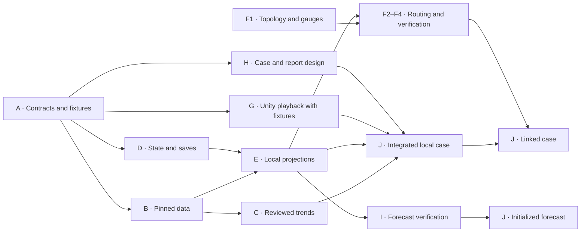

# The Great Homecoming — Earth System Trend Detective implementation plan

**Status · 2026-11-14.** The local Unity scenario, historical investigation and report are integrated. The guided globe flight compares reviewed historical evidence. The Potomac routing screen and Phoenix benchmark replay informed the release decision. The unchecked items below describe remaining work or incomplete acceptance criteria.

| Scope | Delivered | Open |
| --- | --- | --- |
| P0 · Historical investigation | Six terrain presets with packaged history, Central Chile as an additional historical point, a reviewed Sahel–Chile paired trend, a reviewed Phoenix temperature record, and a descriptive Phoenix POWER–IMERG cross-check. | Custom requests work through the web API. Unity's custom-location client and save integration are pending. |
| P0 · Local scenarios | Twelve months of editable weather from committed state, a same-start reference, explicit advance, persistent branches, replay, separate story and lab entry, and local report export. Phoenix uses a 150 mm uncalibrated teaching bucket. The other sites use illustrative indices. | Multi-site physical validation, sensitivity presets, exact footprint overlays before scenario descent, and broader keyboard-only playthrough verification remain open. |
| P1 · Downstream | Verified directed topology, incremental catchment areas, gauge and NASA forcing coverage, a volume ledger and held-out screening with two benchmarks. | The screened model missed climatology at all gauges. A validated stateful runoff model and perturbation response are needed for a causal flight. |
| P2 · Forecast | Replayed 120 issuance dates and evaluated 12 leads using contemporaneous Phoenix NWS reports against later NOAA station observations. | Independently verified initialized forecasts, forecast updates, and a reviewed ENSO case. |

[Unity walkthrough and controls](../unity/README.md) · [Pinned evidence and review](homecoming-evidence.md) · [Routing and forecast screening](homecoming-routing-forecast.md)

**Goal** · Give the player a case to solve, let them test a prediction on a world that retains their changes, and take them to the places where the evidence leads. The finished report answers **what changed, where, by how much, and whether the historical trend is statistically significant**.

## 1. What the player does

| Moment | What the player sees and does | What the game records |
| --- | --- | --- |
| Open a case | Choose a variable and a place on the globe, or open a guided case. The assignment names a question, such as “Does rainfall change the same way in these two regions?” | Case scope, region footprint, variables, available records and an optional first guess |
| Inspect the record | Follow a multi-year chart. Select annual values, one calendar month across years, or a seasonal anomaly view. Pin a finding that names the place, period, rate and significance status. | Dataset and version, exact analysis window, method, estimate, uncertainty and review status |
| Make a prediction | Pick a measurable outcome before viewing the scenario result. Example · “More water will reach the middle river reach before the lower reach.” | Branch and revision, target, metric, time window, threshold or direction, and selected comparison |
| Change conditions | Adjust one or more inputs and preview 12 months from the current world state. The chart and landscape share the same month cursor. | A draft and its input snapshot. The committed world is updated separately when the player advances |
| Follow the evidence | Descend to the selected site, then follow the strongest eligible signal to the next site. Each stop shows what changed and how that site is related to the first. | Monthly results, relationship provenance, route, local/remote contribution and any uncertainty |
| Carry the result forward | Advance the world, then alter one input on the next turn. Keep the other active inputs and carry resulting land and routed-water state forward. Fork a branch to test a competing explanation. | A dated, replayable revision with the inherited and edited inputs visible |
| Submit the case | Compare the prediction with the result, file a second finding or a documented reason a link could not be established, and submit the four-answer report. | A complete case linked to its evidence and scenario runs. Unity invokes the existing hearing and epilogue |

**Guided case endpoint.** File a historical finding for the origin and one comparable finding or documented coverage gap for the second location. Record a prediction, commit one run, and commit a follow-up from the resulting state with one deliberate edit. File a statement about the link and its strength. A wrong prediction earns completion when the player accounts for the discrepancy. An unresolved trend or unsupported link is a valid result with a stated reason. An arbitrary number of discoveries does not determine completion.

**Free investigation endpoint.** Pin a historical finding, file a second comparable record or explain why a comparison is unsupported, and complete the four-answer report. Where a scenario model covers the selected place and variable, the player can add a prediction and runs. Guided play always has a supported scenario. Sandbox play remains open after the hearing.

### Playable ideas

| Priority | Idea | Interaction and payoff |
| --- | --- | --- |
| Release | **Follow the water** | Start at an upstream reach, change rain, and watch a month-by-month water ledger. The camera follows the river when a computed downstream change crosses the case threshold. At each stop, the player sees incoming flow and local rain separately and makes a prediction about the next reach. |
| Release | **Two places, one measurement** | Place the same rainfall product and period side by side for two regions. Make a direction call for each, inspect the two rates, then open a third chart of the paired difference. A preselected case may yield opposite directions, similar rates or inconclusive evidence. The game uses the computed result. |
| Release | **Same weather, different ground** | Take a wet and a dry branch back to identical forcing. Scrub the same month in both and see how stored water changes what happens next. The “fork here” action creates a reproducible test of whether prior state matters. |
| Release | **Let the river answer** | Before the globe moves, the player chooses whether the next gauge will rise, fall or register little change. Reveal the reach, its lag at supported resolution, and the computed delta. If the route produces no clear change, leave the camera on the original site and show why. |
| Later | **The ocean was the clue** | Show the same historical ENSO phase over several regions with a common clock and season-matched precipitation maps. Let the player explain why the regions can respond differently. A shared driver earns a different report conclusion from a routed flow. |
| Later | **Two witnesses disagree** | Overlay matching portions of MERRA-2 and IMERG, with a ground station when comparable. Let the player choose the best footprint for the question and explain how scale, product or period accounts for disagreement. |
| Later | **One more month of evidence** | Reveal one archived month at a time in a historical replay. Let the player revise their forecast after each reveal, then score against observations that were withheld at issuance. |

## 2. Challenge coverage and scientific rules

The required path is variable selection → regional acquisition → a sufficiently long time series → quantitative trend estimation and a significance assessment. Cross-region play and scenario prediction extend that investigation. The official brief allows simple linear trends and lists seasonality, variable definitions and examples as considerations. [NASA Space Apps challenge and objectives](https://www.spaceappschallenge.org/2026/challenges/earth-system-trend-detective/)

| Question | Player-facing answer | What has to be computed |
| --- | --- | --- |
| What is changing? | Variable, definition, unit and estimated direction. | Canonical variable ID, source class and sign of the descriptive slope. |
| Where? | Exact footprint, pin or catchment outline, plus the source grid or gauge. | Source cells/weights or station identity. For a second place, matched scope metadata and shared dates. |
| How much? | Rate per decade, fitted change over the sampled span, and model deltas in physical units where applicable. | Theil–Sen slope on dated points, slope × elapsed span, and scenario-minus-reference changes. A slope, endpoint difference and scenario delta each get their own label. |
| Is it significant? | **Significant**, **Not statistically significant**, or **Significance not established** with the reason. | The existing prespecified primary test for an eligible reviewed record, a reported p-value and an assumption-appropriate interval. For a paired comparison, test the difference series under its own review. |

### What each line on the chart means

- **Historical record** · A dated satellite estimate, gauge measurement or reanalysis. Trend significance is available only under the documented review for that product, footprint, time treatment and window.
- **Stateful scenario** · A conditional 12-month projection under the active forcing. Show departures from the matched counterfactual and sensitivity to uncertain parameters. Scenario months do not enter the historical trend test.
- **Initialized forecast** · A later feature with a dated initial state, future forcing or provider ensemble, and demonstrated skill at each exposed lead. Show the initialization date, latest available input dates, prediction range and benchmark. A 12-month scenario remains available when a forecast supports fewer months. [Copernicus guidance on hindcasts and forecast interpretation](https://climate.copernicus.eu/how-read-c3s-seasonal-forecasts)

### What a line between places means

| Relationship | Rule for selecting the next scene | Claim the report may make |
| --- | --- | --- |
| **Modeled downstream effect** | A supported directional route carries additional or reduced volume from the perturbed catchment and produces a qualifying change at a downstream site. | Under these inputs and this routing model, part of the change reached the downstream site. |
| **Shared driver** | A documented common driver and a seasonally aligned historical response are available for both places. | The places showed these historical responses during the same driver phase. |
| **Historical comparison** | A compatible variable and record are available over a common period. | The records had these rates and this estimated difference. |
| **No supported continuation** | The source footprint is outside the validated network, the apparent effect is below the threshold, or the evidence is incomplete. | Describe the local result and the specific reason the route stops. Offer comparison when a compatible record exists. |

A rainfall dial applies within its selected area. Every remote effect needs an explicit modeled transfer. Distant responses to ENSO belong to a shared-driver case. Pairwise correlation, visual proximity, or a large change at the origin never creates a downstream link. [NOAA Physical Sciences Laboratory ENSO composites](https://psl.noaa.gov/enso/comp.html)

## 3. Repository starting point before implementation

| Existing work | Reuse and gap |
| --- | --- |
| [Unity field controller](../unity/Homecoming/Assets/FieldSimulation/Runtime/FieldSimulation.cs) and [model](../unity/Homecoming/Assets/FieldSimulation/Runtime/ClimateModel.cs) | Completed runs already persist a per-site terminal land state. Weather settings are a single session value, the lab restores normal weather for display, and monthly inputs/results, a shared clock and branch history are absent. The formulas tune a local gameplay response and do not transport water between sites. |
| [Field world](../unity/Homecoming/Assets/FieldSimulation/Runtime/FieldWorld.cs), [interface](../unity/Homecoming/Assets/FieldSimulation/Runtime/FieldInterface.cs) and [builder](../unity/Homecoming/Assets/FieldSimulation/Editor/FieldSceneBuilder.cs) | Reuse orbit, descent, first-person movement, rain, 3D props and typography. Feed them dated results from the new model. Existing water height and vegetation visuals are illustrations and should carry that label even when driven by physical outputs. |
| [Unity export](../scripts/prepare-unity-simulation.mjs), [Earth archive](../public/data/earth-archive.json) and [climate normals](../public/homecoming/regional-climate.json) | Six presets have NASA POWER/MERRA-2 normals and historical records for rain, temperature, humidity, wind and root-zone wetness. Phoenix also has an IMERG rain series in the current Unity export. The Unity export retains annual points and a descriptive slope. It needs versioned monthly values, exact footprints and analysis results. The [quality summary](member-3/quality-report.md) documents gaps and coverage. |
| [Variable catalog](../src/lib/catalog.ts), [regional data client](../src/lib/power.ts) and [time-series route](../src/app/api/timeseries/route.ts) | Reuse variable definitions, the web acquisition path, and the existing paired rainfall case as a candidate. Preserve exact provider footprints. The NASA POWER regional monthly endpoint accepts one parameter per request. [NASA POWER Monthly API](https://power.larc.nasa.gov/docs/services/api/temporal/monthly/) |
| [Time treatment](../src/lib/series.ts), [statistics](../src/lib/stats/trend.ts) and [Member 4 methods](member-4/statistical-methods.md) | Reuse the tested TypeScript implementation, including paired differences. Current code gates inference on review and diagnostics. Member 4’s methods and code describe the current decision rule. Update stale-facing documentation when implementing the shared result contract. |
| [Web What If model](../src/lib/whatif/model.ts) | Reuse the FAO-56 reference ET calculation, vapour-pressure deficit and unit conversion tests. Its present public runner spins up a single-site teaching scenario, and its climate inputs include Phoenix-specific station quantities. Extract a monthly step with explicit state and require documented inputs at every modeled site. [FAO-56 crop evapotranspiration guidance](https://www.fao.org/land-water/land/land-governance-and-planning/land-resources-planning-toolbox/detail/crop-evapotranspiration-%28crop-et0%29/en) |
| [Story scene and session API](../unity/README.md) | Keep `Story.unity`, its shots, dialogue and playback unchanged. Place the new task flow in the simulation scene. Submit through `StorySession.ReturnFromSimulation()` and keep a replayable report in the simulation save. |

## 4. Build checklist

**Priorities** · **P0** is the first complete investigation. **P1** adds a tested directional link and the cross-region flight. **P2** extends the catalog or adds forecasts. Dependencies at the top of each work package apply to the package’s integration and acceptance. Work marked “start early” can use the agreed schema and fixtures while its upstream data is prepared.

### A · Case scope and shared result contract · P0 · Product + engineering · Start here

- [x] **A1** Freeze a one-page scope for the first build. Support the six preset regions for historical investigation, one paired case and one stateful local scenario case. Include model capability per region and variable. Reserve one extra case for a vetted catchment network.
- [ ] **A2** Write versioned schemas for `Region`, `Dataset`, `TrendFinding`, `Relationship`, `Case`, `WorldRevision`, `ScenarioRun`, `ForecastIssue` and `MissionReport`. Define ID rules, field units, allowed enums, null semantics, numeric tolerance and sample documents for absent, unreviewed and reviewed evidence.
- [ ] **A3** Keep historical analysis in the existing TypeScript domain layer. The Unity exporter packages pinned historical results and reviewed pairs. A connected Next.js adapter calls the same code for supported custom historical queries. For interactive offline simulation, extract the TypeScript monthly step as the numerical reference and implement the equivalent pure C# step for the Unity player. Use common versioned inputs and cross-runtime fixtures for calculations both apps expose. The Unity camera and terrain consume results only.
- [ ] **A4** Give the scene a test seam. Provide fixtures for a historical pair with different directions, an ineligible trend, a local 12-month run, two linked basins and a case with no route. Clearly flag these fixtures as QA inputs. Freeze interfaces before parallel integration begins.
- [x] **A5** Specify UI terminology, first-run sequence and endpoint. A “case” collects evidence, a “branch” is an alternate simulated history, and “advance” commits one time interval. Define where the historical and model timestamps appear.

#### Minimum fields to agree on before integration

| Record | Fields needed by the other work packages |
| --- | --- |
| `TrendFinding` | Dataset ID/version/hash, region geometry or station ID, variable, unit, date window, aggregation, analysis mode, point count, descriptive slope and magnitude, primary test/alpha/p-value/interval where eligible, status and withholding reasons. |
| `WorldRevision` | Campaign/branch/revision IDs, parent revision, last committed month, each supported site’s state and forcing schedule, routing queues and model/data versions. |
| `ScenarioRun` | Source revision, exact edits and effective dates, model version, start/baseline definition, dated reference and scenario results per site, diagnostics, eligible relationships and committed month range when advanced. |
| `Relationship` and camera stop | Type, source and target footprint, data or model evidence IDs, eligible month(s), metric, unit, delta, threshold, reason, details link and label. A rejected signal records the reason and stays out of the automatic route. |
| `MissionReport` | Case/branch ID, pinned findings, prediction and result, two committed revision IDs for guided play, relationship statement and submission time. |

Contract status · Evidence pack v2, campaign v2 and report v1 are in use. ET has a cross-runtime arithmetic fixture. The full shared schema set, equivalent web stateful runner and routed gameplay fixtures are still open.

### B · Acquire and package real Earth records · P0 · Data · Needs A2 for export, start inventory immediately

- [x] **B1** Create a coverage matrix from the archive and index. Record footprint type, geometry, dates, units, aggregation, missing months, source product/version, licence and checksum. Verify the non-Phoenix POWER point footprints before drawing any area outlines.
- [ ] **B2** Treat preset region names as display labels only. Bind each finding to a specific footprint. Validate custom coordinates and supported area sizes, respect grid scale, handle date-line wrapping explicitly and use the existing POWER route for supported custom requests. Show which variables and periods the request can return. Batch or cache independent variable requests, with short retries and a saved pinned-data demo.
- [x] **B3** Standardize monthly dates and units across selected datasets. Store precipitation as mm/month using the original product’s encoding and calendar days where conversion is needed. Keep gauge/satellite/reanalysis labels visible. Decide whether “annual precipitation” is a complete-year sum or mean monthly total and use the exact corresponding unit. Preserve null months and incomplete-year flags.
- [x] **B4** Start with MERRA-2 air temperature, rainfall and root-zone wetness. Cross-check Phoenix rain with its already bundled IMERG series using the exact common period and explain footprint/resolution differences. Select any new IMERG series by verified product version, processing run, coverage and latency. [NASA GPM IMERG product and access directory](https://gpm.nasa.gov/data/directory)
- [x] **B5** Vet the existing Sahel–central Chile rainfall case as the first historical comparison. Pin a common date range, the same rainfall product, comparable spatial footprints and a prespecified aggregation. Compute the directions and overlap before locking the case text. If usable coverage or contrast is weak, select a compatible existing pair on documented criteria and withhold confirmatory language until reviewed.
- [ ] **B6** Publish a build-time Unity evidence pack with pinned datasets and a connected mode for custom searches. For custom areas, provide descriptive results until the specified analysis receives a matching review. Allow an area with no valid scenario parameters to complete a historical case.
- [ ] **Acceptance** · Every value in the demo pack traces to its original source and month. Disconnected play opens the curated cases. A custom area with missing data explains the limitation and leaves saved evidence intact.

Coverage status · The curated pack is deterministic and offline. The validated, cached POWER endpoint handles custom requests in the web app. Unity uses the bundled presets.

### C · Historical trend and paired analysis · P0 · Statistics · Needs A2 and B1–B5 for real findings, start fixtures after A2

- [x] **C1** Use `analyzeEvidence`, `analyzeTrend` and `comparePairedSeries` as the existing entry points. Define fixed calendar baseline metadata for comparable anomalies while keeping exploratory period-relative anomalies labelled. Keep time on the actual elapsed-year axis, including gaps. Default the guided case to a prespecified long window.
- [x] **C2** Show a Theil–Sen rate, fitted magnitude, variable unit, direction and sample count. Surface the prespecified test’s own interval and p-value for reviewed results. Explain method differences on a details card. If the review or diagnostics withhold inference, show why and keep the chart and descriptive slope where available.
- [x] **C3** Review at least one real-data test for the judging path. Match review to dataset ID, version, footprint, variable, aggregation/mode, selected dates and month where applicable. Check completeness, residual dependence, outliers, linearity, unequal variance and product discontinuities. If the preset fails, record the reason and use the predeclared fallback case or a justified dependence-aware method validated against fixtures. Never promote a weak design to secure a positive result.
- [x] **C4** Compare A and B over common timestamps and consistent units. Plot each series, then the paired A−B series so simultaneous changes stay paired. Publish separate review status for the difference test. A significant slope at one site and an inconclusive slope at the other does not by itself establish a difference.
- [x] **C5** Predeclare the primary hypothesis and alpha for guided cases. Mark searches over many regions, variables, periods or lags as exploratory. Before adding confirmatory scans, define the comparison family and validate an adjustment such as Holm for valid p-values. Rank exploratory leads by coverage and absolute effect on a common scale, with uncertainty visible.
- [ ] **C6** Render near-zero, missing, inconclusive and reviewed results. Teach “statistically significant” and “large enough to matter” with separate cues. Preserve the exact result the player filed even when a new product version is available.
- [x] **Acceptance** · One reviewed real-data finding produces an honest test decision. An incomplete or unreviewed case explains why significance is unavailable. The same pinned request produces matching numbers in the web and Unity views.

Verified · The paired trend has a reviewed OLS test and confidence interval with the descriptive Theil–Sen rate listed separately. Extra display work remains for sparse data and effect-size interpretation.

### D · Persistent state, branches and iteration · P0 · Simulation · Needs A2–A4

- [x] **D1** Introduce an immutable revision per branch with a single calendar cursor, per-site initial and current land state, per-site active forcing policy, pending route state where relevant, versioned parameters and data fingerprints. Record launch input identity and the monthly trajectory or the inputs and model version needed for exact reproducible replay.
- [x] **D2** Separate **draft**, **preview** and **advance**. Preview computes 12 dated months from revision R and leaves R available for another draft. Advance commits a selected prefix of that exact result, with 12 months as the default and an explicit shorter choice if supported. A second advance from an old revision must prompt refresh or fork. Pause, skip, replay and camera movement leave the world revision untouched.
- [x] **D3** Make slider edits patches against active forcing. Untouched controls keep their per-site values. A new rain setting of +15% replaces that slider’s +20% value, while retaining the other current controls. A deliberate reset changes forcing toward normal and carries soil forward. Give each control an effective start, optional end and unit. Display inherited values when resuming or switching locations.
- [x] **D4** Keep initial, current and hypothetical conditions inspectable on the same calendar. For “effect of this edit,” compare two runs from the same revision, one with inherited forcing and one with the patch. For “effect of the campaign,” fork from the original revision and replay a reference forcing history. Treat different starting ground states as their own comparison.
- [x] **D5** Save via atomic replacement of a versioned campaign file or an equivalently transactional store. Deduplicate advance by command ID and expected branch revision. Restore active branch, case, forcing, and report after a restart. Read the current Unity v1 save as a legacy snapshot, retaining its land state, notes and evidence with provenance. Initialize an explicit campaign start date and known forcing defaults. Legacy weather and synchronized dates are unavailable, so retain elapsed counters as metadata and document the chosen migration mapping.
- [ ] **D6** Record prediction and later revision separately. Support branching from a selected completed revision, comparing branches on common dates, replaying previous outcomes, closing without committing and starting a new campaign explicitly.
- [x] **Acceptance** · Run rain +20%, then adjust heat only. The next preview inherits +20% rain and starts with the prior month’s ending soil state. Reopen the app, switch to another area and back, and get the same values. A cancelled or replayed preview leaves no extra month, discovery, or routing volume.

Verified · The runtime supports cancel, resume, stale and duplicate commands, partial advance, replay, reload, branch isolation and v1 import. The UI supports the current revision and the source of its last run for forks. New-campaign reset is available in the runtime.

### E · Calculate the local 12-month projection · P0 · Simulation + data · Needs A2, B units/initial inputs and D request shape

- [x] **E1** Define inputs by month and site. Ingest documented precipitation, temperature, humidity, wind and the radiation/elevation/daily-range inputs required by the selected ET calculation. Require a calibrated or documented soil capacity for a quantitative water bucket. Keep the existing teaching scenario available with its original illustrative indices when inputs are sparse. Never silently reuse Phoenix-only parameters for another region.
- [x] **E2** Define initial conditions and their dates. Prefer a defensible observed or reanalysis initial value plus documented conversion to model storage. For a normal-based start, spin up once and record the source/method. Preserve an existing committed state on later runs. Soil wetness fractions require a supported conversion to storage in millimeters. Track any different source timestamps.
- [x] **E3** Refactor the existing FAO-56-inspired runner into a deterministic monthly step and explicit initialization. Compute reference ET, constrain actual ET by available water under a documented process order, calculate drainage and runoff separately, and return storage. Verify the land balance as previous storage + local inputs − actual ET − drainage − runoff = new storage within tolerance. Define how zero precipitation, humidity clamps, overflows, leap years and missing forcings behave. Clearly label unsupported cases such as ungauged managed systems or snow processes outside this model’s scope.
- [ ] **E4** Start scenario weather from the case’s chosen dated input sequence or seasonally aligned normal. Apply the active forcing schedule exactly once per month. Emit reference, scenario, delta, storage and runoff for each date. Define realistic parameter bounds before exposing sensitivity presets.
- [ ] **E5** Validate units and arithmetic against independently calculated fixtures. Use archived start states and historical forcing to run hindcasts. Compare predicted soil wetness or runoff with usable independent references where possible, using separate calibration and verification dates. Report accuracy and uncertainty for each supported variable. Use current soil state and seasonal climatology/persistence as simple benchmarks.
- [x] **E6** Drive rendering from calculated quantities. Example · Higher root-zone storage raises the illustrative standing-water blend only after a documented threshold, while modeled rain changes particles and audio. Physical results live in chart and ledger units. Interpret vegetation and terrain visuals as illustrative unless a validated model supports their values.
- [x] **Acceptance** · Same inputs and model version yield the same monthly outputs. Identical inherited/scenario forcing yields zero intervention effect. Under identical new forcing, wet and dry forks differ until their storage trajectories converge. Full replay reproduces a committed trajectory.

Verified · The Phoenix 2021–2024 standardized wetness-anomaly comparison yielded MAE 0.417 for the bucket, 0.570 for climatology and 0.378 for persistence. The comparison shares reanalysis inputs. The bucket capacity and conversion to observed millimeters remain uncalibrated.

### F · Downstream routing and shared-driver cases · P1/P2 · Data + simulation + statistics

- [x] **F1** **P1, start early.** Scope a three-stop downstream demonstration. Candidate · Potomac River at Paw Paw, Hancock and Point of Rocks. Verify directed connectivity in HydroBASINS and HydroRIVERS, use incremental catchments so nested areas are counted once, and acquire gauge discharge and NASA precipitation over a common window. Audit reservoirs, tributaries and gauge changes before committing to the network. Choose a simpler documented network if regulation dominates. [HydroBASINS topology](https://www.hydrosheds.org/products/hydrobasins) · [HydroRIVERS technical documentation](https://data.hydrosheds.org/file/technical-documentation/HydroRIVERS_TechDoc_v10.pdf) · [USGS daily water data](https://api.waterdata.usgs.gov/) · [Point of Rocks station remarks](https://waterdata.usgs.gov/nwis/uv?agency_cd=USGS&legacy=1&site_no=01638500)
- [ ] **F2** **P1, needs D1, E3 and F1.** Create a small directed catchment graph with reviewed boundary geometry, contribution areas, supported time step, outlet nodes and routing parameters. Convert local runoff depth to volume using incremental area. Move volume through travel/storage queues or a documented reservoir step. Account for inflow, outflow, in-transit volume and explicitly modeled losses. Route in topological order with defined same-step delivery semantics and reject invalid/cyclic topology at load. Preserve the route state on each revision.
- [x] **F3** **P1, needs F2.** Calibrate the routing against a training period and evaluate on a held-out period against gauges. Compare with a simple reference such as the matched seasonal normal or unrouted inflow. Set display thresholds using case units and model sensitivity before the demo. Monthly routing may put upstream and downstream change in the same month. Claim a finer delay only if the model and input resolution support it. Document the threshold, sign, peak/total and spill beyond month 12.
- [ ] **F4** **P1, needs F2.** Compute the downstream response against the same-start unedited run. Replay an origin-only edit with downstream forcing held fixed to get a conditional routed contribution. If the player edits downstream forcing as well, show its separate counterfactual and acknowledge any interaction. Rank eligible stops by the prespecified threshold and arrival order, with a deterministic tie-breaker. An unsupported edit offers a nearby historical comparison only when data supports one.
- [ ] **F5** **P2, shared driver can start after B1 independent of F2.** Pin a published NOAA ENSO index version. Choose seasons, regions, a precipitation product and any lags in advance. Align index publication timestamps, use a fixed reference and treat overlapping 3-month windows as dependent. Estimate phase composites and uncertainty by year/event blocks. Test stability on held-out events and include an eligible neutral comparator. Route from the shared driver to each location. [NOAA Relative Oceanic Niño Index](https://www.cpc.ncep.noaa.gov/products/analysis_monitoring/enso/roni/) · [NOAA historical ENSO composites](https://psl.noaa.gov/enso/compare/index.html)
- [ ] **Acceptance** · An upstream perturbation changes a supported downstream output by a computed amount. Water is accounted for across the network. Upstream and unconnected controls stay unchanged by routing. If calibration or the effect threshold fails, the game keeps the historical comparison route available with its own label.

Screening outcome · The monthly model missed the seasonal baseline at Paw Paw, Hancock and Point of Rocks. Both downstream fits selected same-month release. Runtime routing and ranked causal stops remain open. The historical flight is available.

### G · Globe, ground view and accessible playback · P0/P1 · Unity · Start with A4 fixtures, integrate after C/D/E/F

- [ ] **G1** Reuse the flight deck, orbital approach, terrain and first-person exploration. Bind the variable selector, region, product and timeline to the same result IDs. Show exact boundaries or a station marker on the globe before descent.
- [x] **G2** Put a compact chart, month scrubber, weather edits and “compare before run” in the field view. Let the player inspect February of two branches side by side with the same scale. Make play, pause, seek, restart and reduced motion accessible by keyboard. Include a data table for chart inspection.
- [ ] **G3** Build the camera sequence from a route manifest. Reveal the origin and first response, rise to the globe, show the type of connection and its magnitude, then glide to the next stop. Split a globe-to-globe comparison from a physical river trace using distinct labels and line treatment. Choose no more than two automatic stops per turn. Let the player skip immediately, pause at a stop or inspect all eligible destinations from the globe.
- [ ] **G4** Preserve the shared time cursor through the flight. Use playing/scrubbing as presentation state and keep calculation and saving outside camera callbacks. Preload the next stop while the current stop is visible. Use the globe and chart when a detailed terrain scene is unavailable. Reduced-motion mode jumps directly to the same evidence.
- [ ] **G5** Create one honest visual cue per scientific mechanism. Example · Animate water along the activated river reach, then pulse the downstream gauge when its own computed value changes. For a shared-driver case, highlight the ocean region before highlighting each response footprint. For the historical pair, run a synchronized chart insets comparison.
- [ ] **Acceptance** · The case can be completed with transitions skipped, audio muted and from keyboard controls. Pan targets and displayed numbers match the route manifest. Check a smooth first descent and stop transitions at the demo resolution on the actual Mac.

Verified · Direct-entry playback at 1440×810 rendered the chart, field and historical flight. The supplied comparison uses exact pinned locations, matched dates, a skip control and reduced motion. Routed movement and a comprehensive keyboard-only walkthrough are open.

### H · Case objective, report and ending · P0/P1 · Product + Unity · Design after A, integrate after C/D/G

- [x] **H1** Implement case state and visible steps in the simulation scene. Suggested labels · Open record, Make a call, Run the test, Check another place, Submit report. Derive checkmarks from actual evidence, prediction and revision IDs. The player can always see what unlocks the next action.
- [x] **H2** Store structured claims linked to historical findings, scenario runs or relationship records. Include the question, variable, units, place, period, rate, magnitude, test or withholding reason and provenance. Include prediction result and what the second iteration changed. Use a deterministic report template and permit a short player-authored conclusion.
- [ ] **H3** Ask the player to choose a relationship statement with evidence attached. Accept an uncertain or unsupported result where appropriate. Keep achievements for activities such as testing a counterexample or checking a second product. Completion comes from the case requirements.
- [x] **H4** Gate submission on complete evidence and interpretation, then persist the case ID, branch, linked calculations and report. Export a readable Markdown or JSON report using local files, with a compact summary for judging. Invoke the existing story handoff and allow the report to be revisited from the field scene.
- [x] **H5** Add two watchable onboarding runs. The first uses a reviewed historical pair and ends at “what changed.” The second changes rain, advances the soil state, changes only heat and compares the second projection. Include the river flight in the second demo only after F passes.
- [x] **Acceptance** · A player can win after an incorrect prediction if the evidence and explanation are complete. The hearing starts once for each explicit submission. `Story.unity`, the film assets and story timing pass the existing smoke check and file comparison.

Verified · The QA case required an explanation for a deliberately wrong prediction and both committed revisions. The reviewed case wrote a JSON report and invoked the hearing. The story scene, script and film were compared byte-for-byte with HEAD.

### I · Forecast from newly available data · P2 · Data + statistics · Needs B, D, E and F where routing is used

- [x] **I1** Build a replay first. For each issue date, use only observations and forcings that would have been published by that date. Record possible late products and revisions. Forecast against withheld observations using rolling origins or held-out blocks, with leakage checks.
- [ ] **I2** Compare persistence, month-of-year climatology and a stateful model driven by a pinned ensemble or supported predicted inputs. Compare by variable, site and lead. For point outputs report MAE or RMSE and skill versus both baselines. For probability or interval outputs use calibration/coverage and proper scores with the appropriate sample counts. Calculate skill before describing performance to players.
- [x] **I3** Publish only leads with usable verification. Label remaining months as a conditional scenario whenever such an extension is offered. Keep ensemble members or interval derivation, coverage dates and calibration windows traceable. If no model shows useful skill for a location, expose the benchmark or the scenario with the matching label. [Copernicus seasonal forecasts and skill documentation](https://cds.climate.copernicus.eu/datasets/seasonal-postprocessed-single-levels?tab=quality_assurance_tab)
- [ ] **I4** When new data arrive, create a new dated initialization with source and version, retain the old issued forecast, and show how the new initial state changes the projection. Keep observation updates on the real-data timeline separate from a player’s hypothetical branch. Expose “as of” dates and the time elapsed between initial state and display.
- [ ] **Acceptance** · A recorded replay proves the forecast used only data available by issuance. Each advertised lead has published verification across held-out issue dates. New observations produce a new forecast record while older issued forecasts remain reproducible.

Benchmark outcome · The maximum improvement over climatology across 12 leads was 1.4% (under 0.02 °C MAE). The two-month decay is a benchmark specification. Conditional scenarios remain available. Ensemble-driven forecasts and calibrated ranges are open.

### J · Verification and delivery · P0/P1/P2 · QA + each owner · Start fixtures after A4

- [x] **J1** Add source and statistics checks for exact footprints, dates, leap years, rainfall sum/mean labels, null propagation, compatible pairs, conservative significance labels, invalid/stale review, tested case IDs and deterministic exports. Reuse the repo’s reference fixtures.
- [x] **J2** Verify state boundaries. Test cancelled preview, resume, reload, mixed edit/advance, compare, stale revision, duplicate command, altered configuration, chronological year rollover, v1 migration, partial advance and branch isolation. Run the same model fixtures in the web domain and Unity adapter where both compute.
- [ ] **J3** Verify model and rendering end to end. Capture normal-to-wet and wet-to-drier runs, compare matched charts at the same date, test a supported linked effect and no-link run, and confirm exact volume accounting. Check timing, terrain and numbers through 12 months with and without optional flight.
- [ ] **J4** Test the full user journey from a clean save in the macOS player. Cover normal story entry, direct scene entry, reviewed historical result, unresolved comparison, two iterations, completed report and hearing. Run the existing Unity story smoke check plus `npm test`, `npm run typecheck`, `npm run lint` and `npm run build` for any web changes.
- [ ] **J5** Freeze pinned demo data, cache/provider failure behavior, licences, credits and a judge-friendly capture. Provide a short readme with exact steps, model assumptions and evidence provenance. Verify the offline build with network access disabled and confirm that screenshots, report and numbers refer to that build.

Verification · All 89 Vitest tests, typecheck, lint, production build, deterministic pack, Unity model validation and existing story smoke passed. A clean QA player exercised direct lab entry, the paired result, two advances, coverage gap, report export and hearing with network access denied. A story-first player reached the lab using the briefing's scene reference. The story-first click-through and a full keyboard-only playthrough remain unverified. The web build reported a fallback warning for Atkinson Hyperlegible Next.

## 5. Parallel work and integration gates

Treat letters as owners’ work packages. Suggested split for four people is **data**, **statistics**, **model/state**, and **Unity/product**. QA starts with fixtures inside each lane and comes together at the gates. Assign a single owner to each Unity scene or prefab and each shared contract to avoid conflicting asset or schema changes.

| Wave | Can run in parallel | Must wait |
| --- | --- | --- |
| **0 · Define contracts** | A1/A5 case design, B1 inventory, F1 catchment screening, visual sketches and existing-scene review | Code integrations wait for A2–A4’s versioned contracts, units, fixture examples and runtime decision. |
| **1 · Build against fixtures** | B acquisition/export, C trend logic and review checklist, D revision storage, G camera and HUD with fixture data, H report mockup, J test harness | C’s real test decisions wait for pinned B records. E can build pure primitives now. Final model integration waits for input units and D’s state/step contract. F1 can screen topology, gauges and data without waiting for the local engine. |
| **2 · Join the local investigation** | C reviews B’s historical pair while E verifies D-backed projections. G builds the historical view when C lands and plugs in scenario playback as E lands. H wires the report from stable result contracts. | A playable local case needs C + D + E + G + H. J verifies the exact joined build. Routed physics starts integration once F1 and E3 are ready. |
| **3 · Join the cross-region flight** | F2 routing tests and G3 camera animations run in parallel against the route fixture. F5 ENSO data work can proceed separately. | Downstream claims and live flight targets wait for F1 → F2 → F3/F4. H and J check that each stop label and submitted number matches the validated result. |
| **4 · Add initialized forecasts** | I can prepare historical replay data in parallel with final UI polish after B, D and E stabilize. | Publish forecast leads only after I1 → I2 → I3 passes. A routed forecast also requires F. Feed the resulting versioned issue records into G/H only after verification. |

### Serial sequences that cannot be reversed

1. **Historical findings** · Pin source, footprint and measure → choose aggregation/test/window → inspect assumptions → calculate → export and file.
2. **A committed simulation turn** · Read the branch revision → resolve active forcing and edits → calculate local and supported remote monthly state → commit that trajectory once → use its terminal state as the next input. Playback can be replayed or skipped independently.
3. **A downstream claim** · Confirm topology and gauge coverage → calculate local runoff and route volumes → evaluate against withheld observations → derive eligible camera stops → show and file the conditional effect.
4. **A hearing** · File evidence and compare runs → validate the report requirements → persist the report → invoke the existing hearing handoff.
5. **A forecast label** · Freeze issuance dates and benchmark → run leakage-safe hindcasts → verify per-site/per-lead skill → show a dated forecast.

## 6. Release gates and judge walkthrough

- [x] **P0 · Solve a case.** A player chooses a supported Earth variable and location, sees a multi-year record and submits a report with rates and a defensible significance status. At least one guided result exercises real reviewed inference. The local 12-month scenario calculates from current state and carries every committed effect into the next run. The build remains demonstrable with a historical comparative flight when the routed case is pending.
- [ ] **P1 · Follow a real mechanism.** A conditional upstream edit changes downstream flow in a verified network, and the globe follows the first eligible reach. A legitimate no-effect run ends at the origin with its evidence. Show the mechanism and a water ledger on demand.
- [ ] **P2 · Predict from a new state.** Historical replays verify improvement or quantify the limits of the initialized forecasts at the leads shown. Bundled ENSO cases explain how distant regions can share a driver.
- [x] **Walkthrough.** Open a rainfall case and predict each direction. Pin both rates and the significance decision. Show the same-origin 12-month reference and edited field views, then change only one input on the next turn and verify the carried state. Pan to the supported second area, open its chart and relationship explanation, then submit the four-answer report and play the existing ending.
- [x] **If time is tight.** Cut new terrain variants, global scans, extra drivers and live forecasts first. Deliver one complete case, one well-tested local projection, the saved second turn, a truthful cross-region comparison and the existing ending. Add the downstream case when the data and routing checks pass.
